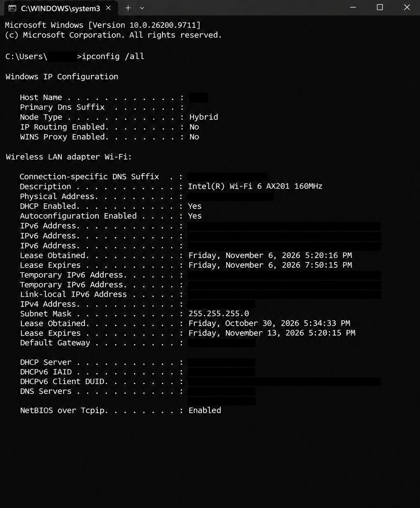
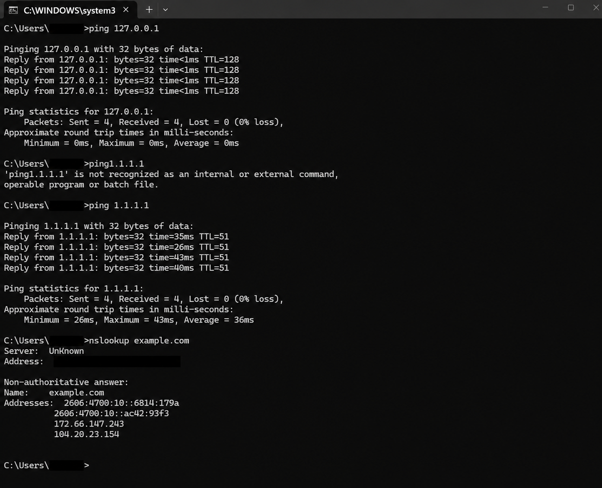
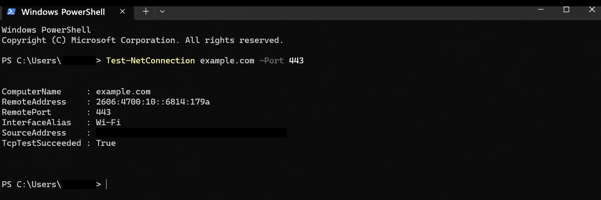
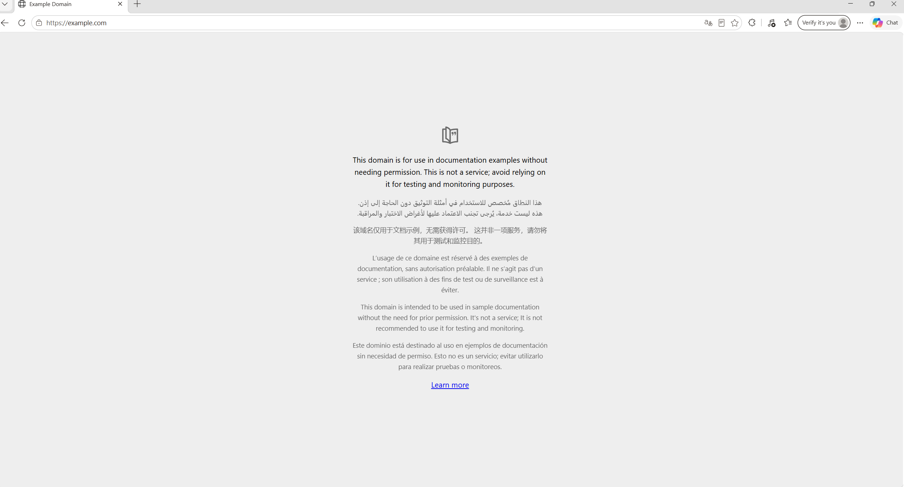

# Incident HD-001 — Company Portal Unavailable in Edge

**Exercise:** Fictional Tier 1 help desk scenario  
**Technician:** Juanmanuel Flores Castellanos  
**Requestor:** Sarah Mitchell (fictional), Accounting  
**Priority:** P3 / Medium (training assumption)  
**Category:** Browser / Website access  
**Final simulated status:** Resolved; user confirmed access  

## User report

The company portal loads indefinitely in normal Microsoft Edge and eventually returns `ERR_CONNECTION_TIMED_OUT`. Other websites work. Portal access worked the previous day; the employee needs access to accounting reports.

## Troubleshooting timeline

| Step | Action / question | Simulated finding | Interpretation |
| --- | --- | --- | --- |
| 1 | Ask for exact symptom | Edge reports a connection timeout; other sites work | Not a confirmed general outage |
| 2 | Restart affected workstation | No improvement | Restart did not resolve issue |
| 3 | Ask if others can access portal | Coworker and phone on office Wi-Fi can access it | Broader outage less likely |
| 4 | Try same URL in Chrome | Portal works | Problem potentially Edge-specific |
| 5 | Try Edge InPrivate | Portal works | Normal profile/session or extension is implicated |
| 6 | Ask about recent changes | Tab-organizer extension installed yesterday | Plausible recent cause |
| 7 | Temporarily disable extension; retry normal Edge | Portal loads | Strong support for extension interference |
| 8 | Ask user to sign in and open reports | User confirms both work | Simulated service restored |

## Resolution note

The user reported being unable to access the company portal through Microsoft Edge, receiving a connection timeout error. Troubleshooting confirmed the portal was accessible through Google Chrome and Edge InPrivate mode, isolating the issue to the normal Edge browsing environment.

A recently installed browser extension was identified as the suspected cause. The extension was temporarily disabled, restoring access to the company portal. The user successfully signed in and confirmed that the portal and accounting reports were accessible.

## Follow-up and caution

- Leave the extension disabled pending review of its permissions and approval status.
- Do not disable the host firewall, delete a browser profile, or clear saved credentials without evidence and authorization.
- If symptoms recur, capture the URL, exact time/error, Edge version, extension list, and relevant policy/configuration details; escalate as appropriate.
- Disabling the extension correlated with resolution. The exact interference mechanism was not independently established.

## Actual Windows 11 baseline exercise

Separately from the simulated Sarah incident, the technician ran network diagnostics on a functioning personal computer. Reported findings: private IPv4 address, successful loopback and external ping, successful `nslookup example.com`, successful Edge page load, and `TcpTestSucceeded : True` for `example.com:443`. No real portal outage was reproduced.

## Diagnostic evidence

### 1. Network configuration

### 2. Loopback, external connectivity, and DNS resolution

The next single screenshot documents three separate diagnostic commands.

### 3. HTTPS port connectivity

### 4. Browser validation

**Evidence note:** These screenshots show baseline tests on a working personal Windows 11 PC. The redacted images may have been visually reconstructed during editing; the unchanged originals should be retained privately. They do not depict Sarah's fictional company-portal failure.

**Integrity statement:** Sarah, the company portal, the reported browser failure, and its resolution are fictional role-play. The baseline diagnostic commands were real exercises performed on Windows 11, with self-reported results and screenshot evidence. No actual portal outage was reproduced.
