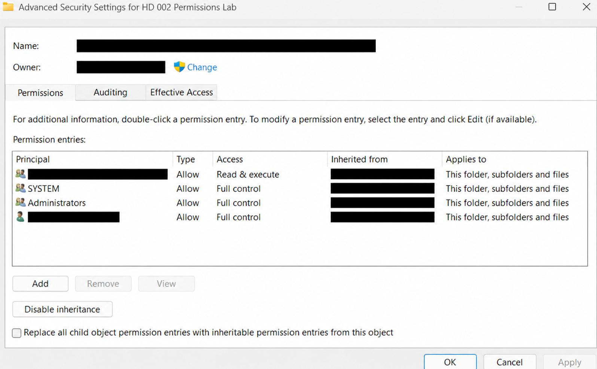
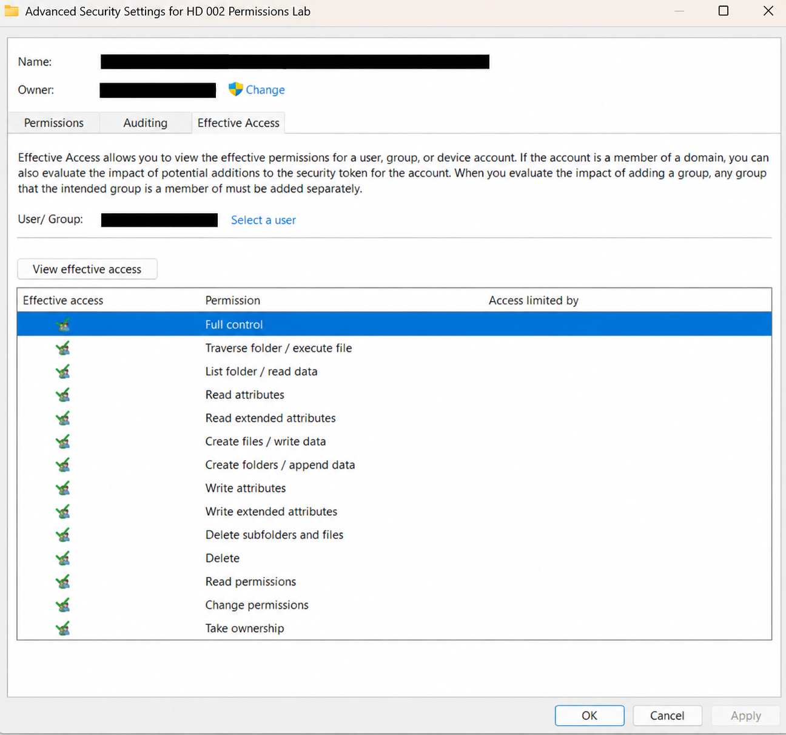
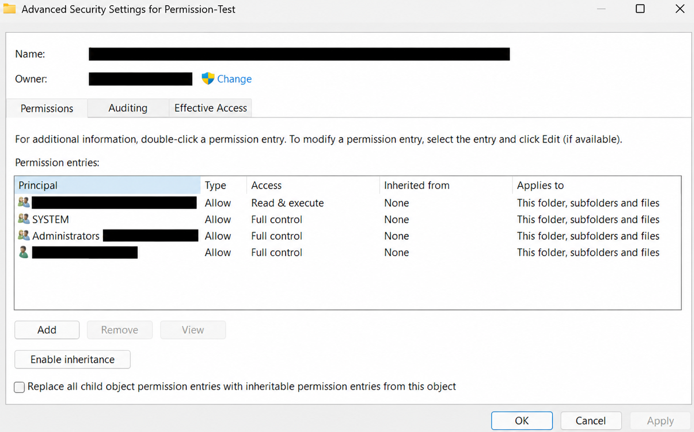

# HD-002 — Windows 11 NTFS Permissions Lab Report

**Technician:** Juanmanuel Flores Castellanos  
**Environment:** Personal Windows 11 computer  
**Scope:** Disposable folders and text documents only  
**Result:** Completed; original inheritance restored

## Objective

Inspect actual NTFS security settings, distinguish inherited from explicit access control entries, observe Effective Access, safely change inheritance on a disposable folder, and validate functionality before and after restoration.

## Lab setup

Created the following structure beneath Documents:

```text
HD-002-Permissions-Lab/
├── Test-Report.txt
└── Permission-Test/
    └── Access-Test.txt
```

The text files contain non-sensitive training content. The screenshots use redacted account and path information.

## Observations and steps

| Step | Actual operation | Observed result |
| --- | --- | --- |
| 1 | Inspect parent practice folder, Properties → Security | Local user account listed with Full Control; Special Permissions checkbox not selected |
| 2 | Open Advanced Security Settings | Entries inherited from a parent path; `Disable inheritance` button visible |
| 3 | Select own account in Effective Access | All shown permissions checked, including Full Control |
| 4 | Create `Permission-Test` folder and `Access-Test.txt` | Folder inherited Full Control for the local user |
| 5 | Disable inheritance on **Permission-Test only** and select **Convert inherited permissions into explicit permissions** | Entries changed to `Inherited from: None`; user retained Full Control |
| 6 | Apply change; edit, save, close, and reopen `Access-Test.txt` | Edit persisted successfully |
| 7 | Enable inheritance again | Inherited entries returned alongside the converted explicit entries |
| 8 | Confirm each duplicate explicit Allow entry matched an inherited counterpart; remove explicit duplicates one at a time | Inherited SYSTEM, Administrators, local user, and sandbox account entries remained |
| 9 | Verify inheritance and account rights again | Inheritance enabled; local user retained Full Control |
| 10 | Edit, save, close, and reopen `Access-Test.txt` again | Final edit persisted; no access error reported |

## Diagnostic evidence

### Screenshot 1 — inherited permissions



### Screenshot 2 — Effective Access



### Screenshot 3 — explicit permissions



## Interpretation

When inheritance was disabled using **Convert**, Windows retained the permissions as explicit access control entries. Re-enabling inheritance added inherited entries again without automatically removing the explicit copies. After confirming matching Allow entries and no Deny entries, the unnecessary explicit copies were removed; access and inheritance were verified afterward.

**The lab demonstrates permission administration and verification, not a reproduced access-denied failure.** The fictional HD-002 incident is documented separately.

## Safety and evidence notes

- Only a dedicated practice folder was modified; Documents and unrelated folders were not changed.
- No permissions were granted to Everyone or unrelated users.
- Sensitive identifiers were obscured before portfolio publication.
- Some AI-edited screenshot copies may contain reconstructed UI pixels. They should be labeled as edited illustrations of observed evidence, and untouched original captures retained privately. Pixel-exact source redactions are preferable for technical audit evidence.

## Outcome

**Pass:** The original inheritance-enabled state was restored and the user could still read and modify the test file.

[Project overview](HD-002-README.md) · [Simulated incident report](HD-002-Incident-Report.md)
